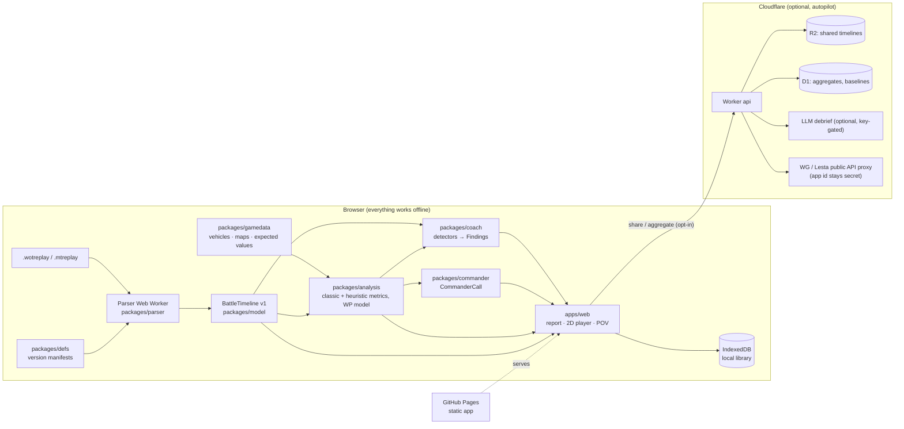

# WoTrep — system design

WoTrep is a web replay analyzer for **World of Tanks** (Wargaming, `.wotreplay`) and **Mir Tankov**
(Lesta, `.mtreplay`). You drop a replay, you watch the battle top-down like a StarCraft replay, it pauses on
your mistakes and good plays, an AI Commander tells you what the right call was at any moment, and you can
open a 3D point-of-view of any single moment.

## 1. What makes us different (product pillars)

| Pillar | Others today | WoTrep |
|---|---|---|
| **Tactical 2D replay** | Static minimap trails, or the in-game replay player | StarCraft-style top-down playback: speeds, pause, scrub, follow-cam, fog of war (what *you* knew), reload timers over enemy tanks |
| **Mistake coaching** | Totals (damage, WN8). No "why" | Detectors find moments, measure their cost in HP / damage / **win-probability**, pause there and show the fix |
| **AI Commander** | — | At any paused second: flank strengths, win %, the one best order. Compare it to what you did |
| **Honest numbers** | WN8 mixes luck and skill | Classic tracker metrics side by side with ours; RNG luck separated from decisions; padding ("cleanup damage") shown |
| **Guides that come from your battle** | Generic YouTube guides | Each finding links a short guide and a drill made from *your* replay ("paused here — what would you do?") |
| **POV moment** | Full 3D replay in the client only | Load one moment in 3D in the browser: terrain, tanks, your aim line |

## 2. Architecture from above



Key decisions (each has an ADR in `docs/adr/`):
1. **Parse in the browser** (ADR-0001). The file never has to leave the user's machine. Zero server cost per replay,
   works on the free tier forever, privacy by default. The server only stores what the user chooses to share:
   the derived timeline (~1–3 MB), not the replay.
2. **One contract between parsing and everything else**: `BattleTimeline v1` (`docs/contracts/battle-timeline.md`).
   Parser agents and UI/analysis agents work in parallel against it from day one.
3. **Versioned manifests, not hard-coded indices** (`docs/REPLAY_FORMAT.md` §6). Supports WG and Lesta side by side.
4. **Deterministic analysis**: every metric, finding and commander call is a pure function of
   (timeline, gamedata, config). Same input → same output, snapshot-tested on fixtures. LLMs only re-word.
5. **Thresholds are measured, not invented** (lesson from PS2 Elite KD): each lives in a config file with provenance
   and is recalibrated from the corpus (E13).
6. **Game assets** (ADR-0003): the hosted site uses only minimap images, icons and public API data. In-game 3D models
   and terrain are loaded **from the user's own game install** in the browser (File System Access API) and never
   uploaded or hosted. Without an install, POV uses simplified generic models. *Owner decision needed* before any
   asset is hosted (label `needs-owner`).

## 3. Repository layout (monorepo, pnpm workspaces)

```
apps/web/                 React 18 + Vite + TypeScript, Zustand state, i18n (en, ru first)
  src/features/upload     drop zone, library (IndexedDB)
  src/features/report     battle report page (scoreboard, classic vs ours, findings list)
  src/features/player2d   PixiJS v8 tactical player
  src/features/pov        three.js moment viewer
  src/features/commander  side panel, debrief
  src/features/guides     guide pages + drills
packages/parser/          container, blowfish, inflate, packets, dispatch, events → BattleTimeline
packages/defs/            manifests/*.json, fingerprint matcher, manifest loader
packages/model/           types, zod schemas, stateAt(), reload estimator, serialization
packages/gamedata/        vehicle + map catalogs, expected values, build scripts (API → JSON)
packages/analysis/        classic metrics (WN8, EFF, …), heuristics, win-probability model
packages/coach/           detectors/, config/, finding builder, i18n message keys
packages/commander/       situation evaluator, order generator, debrief composer
packages/ui-kit/          design tokens, flat square components, icons
services/api/             Cloudflare Worker (share, aggregates, API proxy, optional LLM)
tools/probe/              Python reference decoder (oracle for tests)
tools/defs-extract/       builds manifests from a local game client (never commits client files)
fixtures/                 replays/, expected/, timelines/
docs/                     this design, contracts, ADRs, analyses
```
Dependency direction (enforced by lint, `eslint-plugin-boundaries`):
`parser → defs, model` · `analysis → model, gamedata` · `coach → model, analysis, gamedata` ·
`commander → model, analysis, coach, gamedata` · `apps/web → everything` · nothing imports `apps/web`.

## 4. Data flow and budgets

| Step | Where | Budget (fixture, mid laptop) |
|---|---|---|
| Decrypt + inflate 1.6 MB → 5.1 MB | worker | < 150 ms |
| Packet walk (120k packets) + dispatch | worker | < 400 ms |
| Timeline build + transfer to main thread | worker → main (transferable) | < 150 ms |
| Analysis + all detectors | worker | < 500 ms |
| 2D player | main, WebGL | 60 fps with 30 tanks + 50 tracers, < 150 MB RAM |
| First report paint after drop | — | < 2 s |

## 5. Hosting and operations (copy of what works on PS2 Elite KD)

- Static app on **GitHub Pages** from `main` (`apps/web` build). Deploy is a GitHub Action.
- **Cloudflare Worker** `wotrep-api` (free plan must be enough): `POST /share` (timeline → R2, returns short id),
  `GET /t/:id`, `POST /aggregate` (anonymous per-tank/per-map numbers for baselines), `GET /gamedata/*` (cached
  WG/Lesta API data with the application id as a Worker secret), optional `POST /debrief` (LLM).
- **Autopilot**: no step needs the owner. If the Worker or R2 is down or over quota, the app still works locally;
  share buttons say so. Quotas are checked by a scheduled Action and features degrade, never crash.
- Free-tier first; the paid plan is an optimisation, never a dependency.

## 6. Realms

| | Wargaming WoT | Lesta Mir Tankov |
|---|---|---|
| File | `.wotreplay` | `.mtreplay` |
| Regions | EU, NA, ASIA | RU |
| Public API | `api.worldoftanks.{eu,com,asia}` | `api.tanki.su` |
| Vehicles | WG tree | Lesta tree (own nations, e.g. `intunion`) |
| Expected values (WN8) | tomato.gg / XVM tables | no maintained table → we build our own from the corpus (E5) |

The fixture is Lesta 1.46. WG support needs one WG fixture per supported version (issue in E1).

## 7. Non-goals (for now)

- No live in-game overlay, no mod. Web only.
- No cross-battle tracking of other players' positions. Other players appear only inside a battle's viewer.
- No accusations: when numbers look impossible the UI says "flagged: impossible stats", never "cheater".
