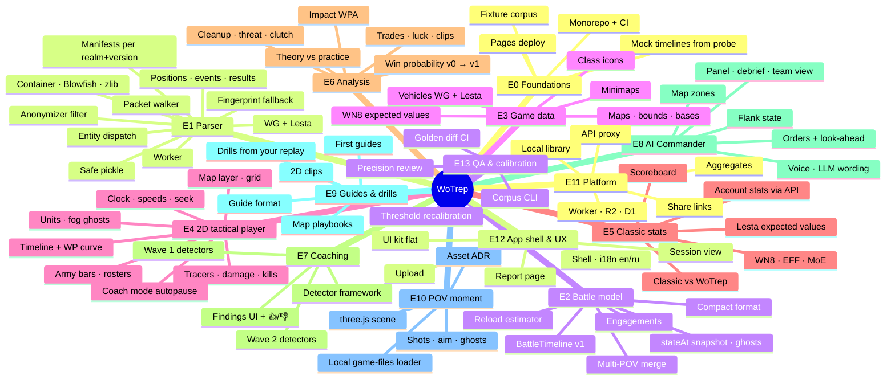

# Roadmap — epics mindmap and milestones

Issue numbers for every epic and task: see the **Epics** table at the bottom (filled after the issues were created).

## Milestones

| | Milestone | Done when | Main epics |
|---|---|---|---|
| M0 | Foundation | monorepo builds in CI, contract types exist, mock timelines in `fixtures/timelines/` | E0, E2-01, E12-01/02 |
| M1 | Parse & Play | drop the fixture → report skeleton + 2D playback with fog ghosts, tracers, kills | E1, E2, E4, E12 |
| M2 | Classic parity | scoreboard + WN8/EFF/MoE match trackers; WG replay supported | E3, E5 |
| M3 | Coach v1 | WP v0, Impact, wave-1 detectors, coach mode, findings with 👍/👎 | E6, E7 |
| M4 | Commander & Guides | zones, commander call/debrief, guides, drills, wave-2 detectors | E8, E9 |
| M5 | POV & Platform | 3D moment, share links, aggregates, WP v1, Lesta expected values | E10, E11, E13 |

Parallel lanes from day one (no waiting on each other once E0-01 and E2-01 land):
**parser lane** (E1) · **player lane** (E4 on mock timelines) · **shell/UI lane** (E12, E5-01) ·
**analysis lane** (E6/E7 on mock timelines) · **data lane** (E3, needs owner for API ids) · **platform lane** (E11).
