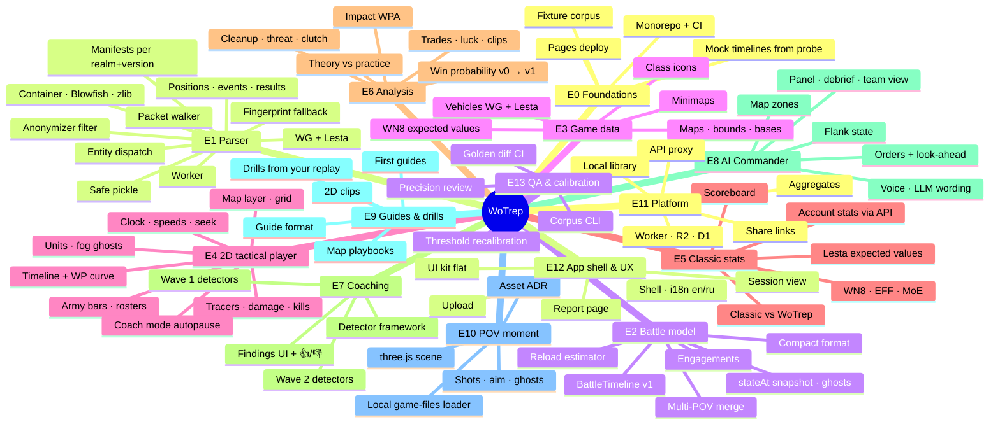

# Roadmap — epics mindmap and milestones

Issue numbers for every epic and task: see the **Epics** table at the bottom. Rendered mindmap: [img/mindmap.png](img/mindmap.png).

## Milestones

| | Milestone | Done when | Main epics |
|---|---|---|---|
| M0 | Foundation | monorepo builds in CI, contract types exist, mock timelines in `fixtures/timelines/` | E0, E2-01, E12-01/02 |
| M1 | Parse & Play | drop the fixture → report skeleton + 2D playback with fog ghosts, tracers, kills | E1, E2, E4, E12 |
| M2 | Classic parity | scoreboard + WN8/EFF/MoE match trackers; WG replay supported | E3, E5 |
| M3 | Coach v1 | WP v0, Impact, wave-1 detectors, coach mode, findings with 👍/👎 | E6, E7 |
| M4 | Commander & Guides | zones, commander call/debrief, guides, drills, wave-2 detectors | E8, E9 |
| M5 | POV & Platform | 3D moment, share links, aggregates, WP v1, Lesta expected values | E10, E11, E13 |

Parallel lanes from day one (no waiting on each other once E0-01 and E2-01 land):
**parser lane** (E1) · **player lane** (E4 on mock timelines) · **shell/UI lane** (E12, E5-01) ·
**analysis lane** (E6/E7 on mock timelines) · **data lane** (E3, needs owner for API ids) · **platform lane** (E11).

## Epics (issue numbers)

| Epic | Issue | Tasks |
|---|---|---|
| E0 Foundations & coordination | [#1](https://github.com/Dayset/WoTrep/issues/1) | 5: #15–#19 |
| E1 Replay parser (WG + Lesta) | [#2](https://github.com/Dayset/WoTrep/issues/2) | 16: #20–#35 |
| E2 Battle model & derived state | [#3](https://github.com/Dayset/WoTrep/issues/3) | 6: #36–#41 |
| E3 Game data (vehicles, maps, expected values) | [#4](https://github.com/Dayset/WoTrep/issues/4) | 6: #42–#47 |
| E4 2D tactical player (StarCraft-style) | [#5](https://github.com/Dayset/WoTrep/issues/5) | 10: #48–#57 |
| E5 Classic tracker stats (parity) | [#6](https://github.com/Dayset/WoTrep/issues/6) | 5: #58–#62 |
| E6 Analysis engine (win probability & our metrics) | [#7](https://github.com/Dayset/WoTrep/issues/7) | 8: #63–#70 |
| E7 Mistake coaching (detectors) | [#8](https://github.com/Dayset/WoTrep/issues/8) | 19: #71–#89 |
| E8 AI Commander (WoT edition) | [#9](https://github.com/Dayset/WoTrep/issues/9) | 9: #90–#98 |
| E9 Advanced guides & drills | [#10](https://github.com/Dayset/WoTrep/issues/10) | 5: #99–#103 |
| E10 POV moment viewer (3D) | [#11](https://github.com/Dayset/WoTrep/issues/11) | 5: #104–#108 |
| E11 Platform (Cloudflare, sharing, aggregates, library) | [#12](https://github.com/Dayset/WoTrep/issues/12) | 6: #109–#114 |
| E12 Web app shell & UX | [#13](https://github.com/Dayset/WoTrep/issues/13) | 6: #115–#120 |
| E13 QA, benchmarks & calibration | [#14](https://github.com/Dayset/WoTrep/issues/14) | 5: #121–#125 |

## Start here (no blockers)

- [#15](https://github.com/Dayset/WoTrep/issues/15) **E0-01** Scaffold the pnpm monorepo and package skeletons
- [#18](https://github.com/Dayset/WoTrep/issues/18) **E0-04** Mock BattleTimeline files from the Python probe
- [#19](https://github.com/Dayset/WoTrep/issues/19) **E0-05** Collect the fixture corpus (needs owner) · `needs-owner`
- [#30](https://github.com/Dayset/WoTrep/issues/30) **E1-11** Research: decode remaining packets (aim, hits, personal events)
- [#31](https://github.com/Dayset/WoTrep/issues/31) **E1-12** Research: 61 tracers vs 59 shots for the recorder
- [#104](https://github.com/Dayset/WoTrep/issues/104) **E10-01** Decide the 3D asset strategy (ADR-0003) · `needs-owner`

Unblocked as soon as **E0-01** (#15) merges: #16 E0-02, #17 E0-03, #20 E1-01, #22 E1-03, #23 E1-04, #36 E2-01, #42 E3-01, #47 E3-06, #109 E11-01, #115 E12-01, #116 E12-02.
