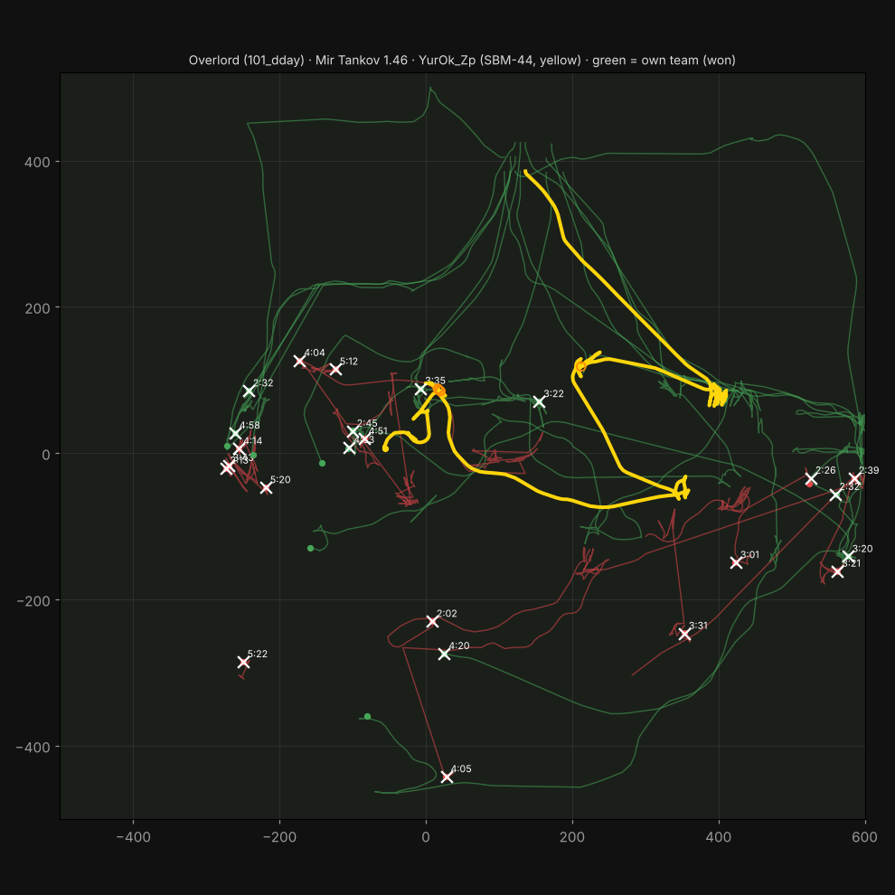

# First replay — manual analysis (what WoTrep should find automatically)

File: `fixtures/replays/lesta-1.46-overlord-sbm44.mtreplay` · Mir Tankov 1.46.0.0 · RU2 · 03.11.2026 20:25
Map **Overlord** (`101_dday`), standard battle, 5:28. Recorder **YurOk_Zp**, SBM-44 (`intunion:Un15_SBM_44`, 1,350 HP,
autoloader, ~50 dmg per pen), team 2. **Victory 15 : 8** (enemy team destroyed).
Produced with `tools/probe/wotrep_probe.py`; numbers below are the acceptance targets for the detectors in E7.

*Yellow = recorder, green = allies, red = enemies while visible (the straight red jumps are the "interpolating
across a fog gap" bug the 2D player must not have), × = kills with battle time.*

## Classic line (from battle results)

| dmg | assist radio / track | blocked | kills | shots / hits / pens | received | survived | XP |
|---|---|---|---|---|---|---|---|
| 1,362 | 56 / 243 | 350 | 1 | 59 / 46 / 28 | 525 | yes, 825 HP left | 862 base |

- 1,362 dmg = **1.73×** the recorder's moving average (785), MoE progress 34%. 6% of team damage.
- Hit rate 78%, **pen rate 61%**: 18 hits did no damage.
- WN8: SBM-44 is a Lesta-only tank → no public expected values → shown as "—" until we build the Lesta table (E5).

## Timeline (battle time)

| time | what happened | detector that should fire |
|---|---|---|
| 0:00–0:40 | Drove from north spawn (136, 385) to the east side (400, 75) at 35–48 km/h | — |
| 0:38 | Braking to a stop (0–19 km/h), opened the clip at the LT Britva ~130 m away: **6 shots, 1 pen, 46 dmg** | `low-yield-clip` |
| 0:40–1:50 | Held east with 3–7 enemies visible at 140–185 m. 1:16: the other 4 shells of that clip, **0 pens** | `low-yield-clip` (same clip) |
| 2:00–2:30 | Relocated west to (209, 116): nearest ally 119–136 m, 7–12 enemies visible | `isolated-under-fire` (borderline: took 104) |
| 2:03–2:05 | Duel with the enemy SBM-44 (sergey126161): **dealt 342, took 104 → 3.3 : 1** | `trade-window-used` / good trade |
| 2:55–2:58 | Full clip into the ELC EVEN 90 (X30D): **10 pens, 493 dmg**; it died at 3:01 to an ally | good: set up a kill |
| 3:21 | Finishing shot on the Bofors Pagod (36 HP) — the only kill | — |
| 3:56–3:59 | Enemy TDM-54 (Tsunemikih) empties its 10-round clip elsewhere | reload model starts the timer |
| **4:13–4:15** | Recorder peeks the TDM-54 with the last 3 shells of a half-spent clip, **exactly when the TDM's reload ends** (~14 s after its last clip): **5 hits taken, −421 HP (31% of max)**, dealt 51 | **`peek-into-loaded-autoloader`** — top mistake |
| 4:28–4:30 | 11 shots at the TDM-54, **1 pen** (52 dmg) — clip spent with almost no effect | `bad-trade` candidate / pen-rate info |
| 4:46–4:48 | Next clip: **6 pens, 293 dmg** on the TDM-54 | good |
| 5:12–5:28 | TDM-54 dies to an ally; battle ends, recorder alive with 825 HP | `survived-unused-hp` must NOT fire (team won) |

Camera: 75 s in sniper mode over 23 short zoom-ins (longest ≈ 7 s) — no tunnel vision.

**Clip economy** (61 tracers ≈ six 10-round clips; per-clip damage sums to the 1,362 total):

| clip | time | shells | dmg | |
|---|---|---|---|---|
| 1 | 0:38 + 1:16 | 10 | 46 | low yield |
| 2 | 2:02–2:05 | 10 | 342 | duel won |
| 3 | 2:55–2:58 | 10 | 493 | 10/10 pens |
| 4 | 3:21–4:13 | 10 | 136 | spread over 52 s (kill shot, pokes) |
| 5 | 4:28–4:30 | 11 | 52 | low yield vs TDM-54 armour |
| 6 | 4:46–4:48 | 10 | 293 | |

Three clips (31 shells) did 234 dmg; the other three (30 shells) did 1,128. That single sentence is the most useful
coaching line in this battle and is exactly what `low-yield-clip` should produce.

## What the coach card should say (target wording)

> **4:13 · Peeked a loaded autoloader · −421 HP**
> The TDM-54 finished its clip at 3:59 and had a full clip again at ~4:13. You peeked it at 4:13 and took 5 shells.
> **Fix:** count its reload (≈ 14 s) from its last shot and peek in the first 10 s after its clip, not after.
> 📖 Autoloader timing · 🎯 Drill this moment

> **2:03 · Won the duel vs the enemy SBM-44 · +342 / −104**
> You shot first from the flank and forced it to trade at 3.3 : 1.

## Lessons for the build

1. Battle start is the arena period 3 update (clock 33.26 s), not clock 0. All times use battle time.
2. Autoloader clips are visible as tracer bursts → the reload model can be fitted from observations even without crew data.
3. "Hits" ≠ "pens": damage events are pens; bounces need `showDamageFromShot` decoding (open question in REPLAY_FORMAT §5).
4. Four players used the anonymizer (results `realName` ≠ name) → the privacy filter is not theoretical.
5. Positions are in metres with x up to 600 here — map bounds must come from the map catalog, not be assumed ±500.
